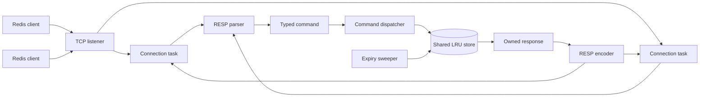

# mini-Redis

An educational, asynchronous in-memory key-value server written from scratch
in Rust. mini-Redis speaks a practical RESP2 subset over raw TCP, so the goal
is compatibility with real Redis tooling rather than another custom demo
protocol.

The project is deliberately small enough to understand end to end, but serious
enough to expose the systems concepts that matter in production services:
incremental byte parsing, TCP message boundaries, pipelining, shared ownership,
async locking, TTL expiration, and LRU eviction.

> **Project status:** core RESP, command, store, and server layers are in place.
> Integration tests, benchmark capture, and production hardening are still on
> the roadmap. This is a learning project, not a drop-in replacement for Redis.

## What It Demonstrates

- Rust ownership, borrowing, lifetimes, and error propagation.
- Tokio-based asynchronous TCP networking.
- One lightweight task per client connection.
- RESP2 parsing and encoding without assuming TCP read boundaries.
- Pipelined request handling.
- A shared `Arc<RwLock<...>>` store.
- LRU eviction with the `lru` crate.
- Lazy expiration on reads and active background expiration sweeps.
- A clean separation between protocol frames, typed commands, storage, and
	network orchestration.

## Supported Commands

| Command | Example | Response |
| --- | --- | --- |
| `PING` | `PING` | `PONG` |
| `GET` | `GET name` | Value or null bulk string |
| `SET` | `SET name Alice` | `OK` |
| `SET` with TTL | `SET name Alice EX 30` | `OK` |
| `DEL` | `DEL name other` | Number of deleted keys |
| `EXISTS` | `EXISTS name` | `0` or `1` |
| `EXPIRE` | `EXPIRE name 30` | `0` or `1` |
| `TTL` | `TTL name` | Remaining seconds, `-1`, or `-2` |

The implementation targets RESP2, which is the protocol mode used by the Redis
CLI and benchmark workflows in this project.

## Quick Start

### Requirements

- Rust stable toolchain with Cargo.
- Optional: `redis-cli` for manual compatibility checks.
- Optional: `redis-benchmark` for throughput measurements.

### Build

```bash
cargo check
cargo build
```

### Run

The default server address is `127.0.0.1:6380`.

```bash
cargo run
```

Configuration is available through command-line options:

```bash
cargo run -- \
	--bind-address 127.0.0.1:6380 \
	--max-keys 10000 \
	--sweep-interval-ms 100
```

The available options are:

| Option | Default | Purpose |
| --- | --- | --- |
| `--bind-address` | `127.0.0.1:6380` | TCP address to listen on |
| `--max-keys` | `10000` | Maximum number of cached keys |
| `--sweep-interval-ms` | `100` | Active expiration sweep interval |

### Connect with Redis CLI

With the server running in another terminal:

```bash
redis-cli -p 6380 PING
redis-cli -p 6380 SET name Alice
redis-cli -p 6380 GET name
redis-cli -p 6380 SET session active EX 30
redis-cli -p 6380 TTL session
```

Expected responses include:

```text
PONG
OK
Alice
30
```

## Architecture



### Request lifecycle

```text
TCP bytes
		-> incremental buffer
		-> RESP frame
		-> validated Command
		-> store operation
		-> owned Response
		-> RESP bytes
```

The connection loop keeps unread bytes in a `BytesMut`. It repeatedly parses
complete frames until the buffer contains an incomplete frame. This is required
because one TCP read may contain half a request, exactly one request, or many
pipelined requests.

## Storage Design

The first store implementation is correctness-first:

```text
Arc
└── Tokio RwLock
		└── Store
				└── LruCache<Vec<u8>, Entry>
```

Each entry contains:

```text
value: Bytes
expires_at: Option<Instant>
```

Expiration has two layers:

- **Lazy expiration:** `GET`, `EXISTS`, `EXPIRE`, and `TTL` check the requested
	key before using it.
- **Active expiration:** a background Tokio task periodically scans the cache
	and removes expired entries even when clients are not reading them.

The current LRU implementation updates recency on lookups. This means cache
reads require mutable cache access and therefore use the store's write lock.
That tradeoff preserves correct LRU behavior in the V1 implementation.

## RESP2 Example

The command:

```text
SET name Alice
```

is transmitted as:

```text
*3\r\n$3\r\nSET\r\n$4\r\nname\r\n$5\r\nAlice\r\n
```

The parser turns this into an array of bulk-string frames. The command layer
validates the array and creates a typed `SET` command. The dispatcher updates
the store, and the encoder returns:

```text
+OK\r\n
```

The parser distinguishes incomplete network input from malformed protocol data:

```text
Ok(Complete(...))  valid complete frame
Ok(Incomplete)     more TCP bytes are needed
Err(...)           invalid RESP data
```

## Repository Layout

```text
mini-Redis/
├── src/
│   ├── main.rs              CLI configuration and startup
│   ├── commands.rs          command validation and dispatch
│   ├── server.rs            TCP listener and connection loop
│   ├── resp/
│   │   ├── mod.rs           public RESP API and response types
│   │   ├── parser.rs        incremental RESP2 parser
│   │   └── encoder.rs       RESP2 response encoder
│   └── store/
│       ├── mod.rs           shared store and operations
│       └── entry.rs         values and expiration metadata
├── tests/                   integration-test plans and tests
├── benches/                 optional parser benchmarks
├── mylearning.md            implementation notes and Rust explanations
├── rust-mini-redis-prd.md   original project requirements
└── Cargo.toml               dependencies and build metadata
```

## Dependencies

- `tokio`: async runtime, TCP, tasks, timers, locks, and I/O.
- `bytes`: efficient mutable buffers and binary-safe values.
- `clap`: typed command-line configuration.
- `lru`: V1 least-recently-used eviction.
- `tracing`: structured application logging.
- `tracing-subscriber`: log formatting and filtering.
- `criterion`: optional parser benchmarks.
- `tokio-test`: asynchronous testing helpers.

`dashmap` is intentionally reserved for the V2 comparison. The project should
first measure the global-lock implementation before changing the concurrency
model.

## Development Workflow

Format and check the project before committing:

```bash
cargo fmt -- --check
cargo check
cargo test
```

The intended validation layers are:

1. Parser unit tests for every RESP type, split input, malformed input, and
	 pipelining.
2. Encoder tests for exact RESP output bytes.
3. Integration tests using a real TCP client against an in-process server.
4. Concurrent-client stress tests with at least 50 clients.
5. Manual `redis-cli` compatibility checks.
6. Reproducible `redis-benchmark` measurements.

## Roadmap

### Core completion

- Add parser and encoder unit tests.
- Add protocol integration tests.
- Add concurrent-client stress coverage.
- Start the server through the CLI and verify it with `redis-cli`.
- Document measured benchmark output rather than estimates.

### Performance comparison

- Capture a V1 baseline using the global `RwLock` and LRU cache.
- Add a DashMap-based experimental implementation.
- Run the same workload and record the throughput delta.
- Keep the V1 baseline available for comparison.

### Deliberate non-goals

Persistence, replication, clustering, Pub/Sub, transactions, Lua scripting,
and full RESP3 support are intentionally outside the first version. The goal is
to finish a small, understandable, measurable server before adding Redis-wide
feature breadth.

## Learning Notes

The implementation is being developed function by function. The reference
notes in [mylearning.md](mylearning.md) record the questions, ownership
decisions, protocol concepts, and debugging lessons encountered along the way.

The original requirements and design tradeoffs are documented in
[rust-mini-redis-prd.md](rust-mini-redis-prd.md).

## License

No license has been selected for this repository yet. Add a license before
distributing the project publicly.