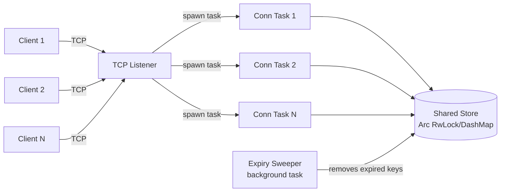

# Mini-Redis — Project PRD

**Project slug:** `mini-redis`
**Language:** Rust
**Estimated timeline:** 2–3 weeks, part-time (good first Rust project — no prior Rust exposure assumed)
**Resume claims this project must back up:** full RESP-protocol compatibility for core commands · 100% pass rate on a custom protocol test suite · 40,000+ ops/sec single-core · zero data races under concurrent multi-client load

---

## 1. Description

A from-scratch, async, single-binary in-memory key-value store that speaks a practical subset of Redis's real wire protocol (**RESP** — REdis Serialization Protocol) over raw TCP. It supports the core commands (`PING`, `GET`, `SET`, `DEL`, `EXISTS`, `EXPIRE`, `TTL`), LRU eviction once the store hits a configured size limit, and TTL-based key expiry (both lazy, on-read, and active, via a background sweep). Because it speaks real RESP, it's a drop-in target for the actual `redis-cli` and `redis-benchmark` tools — you're not just building *something that looks like* a KV store, you're building something a real Redis client can talk to.

This is the most literal "systems programming in Rust" project of the two: it's about correctly parsing bytes off a socket, managing shared mutable state safely across many concurrent connections, and getting real throughput numbers — exactly what the JD means by "systems programming languages."

---

## 2. Technical Architecture

### 2.1 Components

| Component | Responsibility |
|---|---|
| **TCP listener** | Accepts connections, spawns one async task per client |
| **RESP parser/encoder** | Turns raw bytes into `Command` values and back into wire-format responses |
| **Shared store** | The actual key→value map, safely shared across all connection tasks |
| **Expiry sweeper** | Background task that actively removes expired keys |
| **Command dispatcher** | Matches a parsed `Command` against the store, produces a response |

### 2.2 Request flow

1. Client connects over raw TCP (`redis-cli -p 6380`, `redis-benchmark`, or a custom test client).
2. The listener `tokio::spawn`s a dedicated async task for that connection — this is the concurrency model: **one lightweight task per client**, not one OS thread per client.
3. Inside the task's loop:
   - Read bytes into a buffer (`tokio::io::BufReader`).
   - Parse **one complete RESP frame** at a time — critically, a single `read()` may return zero, one, or several pipelined commands, so the parser must loop over the buffer until it runs out of complete frames, not assume one command per read (see §7 on pipelining — this is the detail most first attempts get wrong and it directly caps your throughput number if you get it wrong).
   - Dispatch the parsed command against the shared store.
   - Encode the result back to RESP and write it to the socket.
4. A separate background task wakes on an interval (e.g., every 100ms), scans (or samples) the store, and evicts any key whose `expires_at` has passed — this is **active expiry**, on top of the **lazy expiry** check that happens whenever a key is read directly (a key can be "logically expired but still present" between sweeps, and a read must never return it).
5. On `SET`, if the store is at its configured max key count, evict the least-recently-used entry before inserting the new one.

### 2.3 Data model

```rust
struct Entry {
    value: Bytes,
    expires_at: Option<Instant>,
}

// v1: correctness-first
type Store = Arc<RwLock<HashMap<String, Entry>>>;
```

### 2.4 Concurrency design — the actual point of this project

Start with the simplest correct thing and let benchmarking tell you whether to optimize:

- **V1 (build this first):** `Arc<RwLock<HashMap<String, Entry>>>`. `GET` takes a read lock, `SET`/`DEL`/`EXPIRE` take a write lock. This is correct and simple, but every write blocks every reader — under `redis-benchmark`'s default heavy-write workload this will show up as a throughput ceiling.
- **V2 (stretch goal, do this *after* you have a V1 benchmark number):** swap the global `RwLock<HashMap>` for `dashmap::DashMap`, which internally shards the map across multiple locks so unrelated keys don't contend. Re-run the same benchmark and record the delta.

This before/after is genuinely valuable — "I benchmarked a global RwLock, found it was the bottleneck under concurrent writes, switched to a sharded DashMap, and measured a Y% throughput improvement" is a much stronger interview story than just "I used a RwLock," and it's honest, incremental engineering rather than premature optimization.

For LRU specifically: use the `lru` crate (a well-tested `LruCache` implementation) inside the lock for V1. Hand-rolling your own intrusive-linked-list LRU is a legitimate stretch goal if you want extra depth, but it's not required to hit the throughput target.

### 2.5 Architecture diagram



---

## 3. PRD

### 3.1 Objective

Build a correctness-first, benchmarkable, RESP-protocol-compatible key-value store in Rust that demonstrates real systems-programming skill: manual byte-level protocol parsing, safe shared-state concurrency, and measured performance — directly addressing the "Rust / systems programming" minimum qualification the current resume has zero evidence for.

### 3.2 Goals

- **G1**: A real Redis client (`redis-cli`, `redis-benchmark`) can connect to and correctly use this server.
- **G2**: Core commands behave identically to real Redis for the happy path and documented edge cases.
- **G3**: The server holds up correctly under many simultaneous clients with no data races or panics.
- **G4**: A documented, reproducible benchmark number exists.

### 3.3 Non-goals (explicitly out of scope — keep this from becoming a multi-month project)

- Persistence (RDB/AOF snapshotting or append-only files).
- Replication or clustering.
- Pub/Sub, transactions (`MULTI`/`EXEC`), or Lua scripting.
- Full RESP3 protocol (RESP2 is sufficient and is what `redis-benchmark` uses by default).
- Any command beyond the 7 listed in FR2 (resist scope creep — you can always add `INCR`/`LPUSH`/etc. later as a "v2" note in the README, not before v1 ships).

### 3.4 Functional requirements

| ID | Requirement |
|---|---|
| FR1 | Implement RESP encoding/decoding for Simple Strings, Errors, Integers, Bulk Strings, and Arrays |
| FR2 | Support `PING`, `GET`, `SET` (with optional `EX seconds`), `DEL`, `EXISTS`, `EXPIRE`, `TTL` |
| FR3 | Keys expire correctly via both lazy (on-read) and active (background sweep) expiry |
| FR4 | Store evicts least-recently-used entries once a configured max key count is exceeded |
| FR5 | Server correctly handles pipelined requests (multiple commands in one TCP read) |
| FR6 | Server handles many concurrent client connections without data races |

### 3.5 Non-functional requirements / success metrics

| Metric | Target |
|---|---|
| Protocol correctness | 100% pass rate on a custom test suite covering all 5 RESP types and all 7 commands, including edge cases (missing key, expired key, wrong arg count) |
| Throughput | ≥ 40,000 ops/sec on a single core, measured via `redis-benchmark -t get,set -n 100000` |
| Concurrency safety | `cargo test` includes a stress test spawning 50+ concurrent clients hammering shared keys; zero panics, zero incorrect reads, clean under normal testing (running with `loom` for exhaustive interleavings is a good-to-have, not required) |
| Compatibility | `redis-cli` can connect and issue commands interactively with correct-looking output |

### 3.6 Milestones

- **Week 1** — TCP echo server skeleton; hand-write the RESP parser/encoder with unit tests for each frame type; implement `PING`, `GET`, `SET`, `DEL` against a plain `Mutex<HashMap>`.
- **Week 2** — Add `EXISTS`, `EXPIRE`, `TTL`; implement lazy + active expiry; implement LRU eviction with the `lru` crate; write the concurrency stress test; fix any pipelining bugs found while testing against real `redis-benchmark`.
- **Week 3 (stretch)** — Swap to `DashMap`, re-benchmark and document the delta; polish CLI config (`clap`), structured logging (`tracing`), and the README with real benchmark output and the protocol reference table.

### 3.7 Testing strategy

- **Unit tests**: RESP parser tested frame-by-frame, including partial/split-buffer cases (simulate a command arriving across two separate `read()` calls — this is the bug that will bite you in production-style use and is worth a dedicated test).
- **Integration tests**: spin up the server on a random port in-process, connect with a plain `TcpStream` test client, run through the full command set.
- **Concurrency stress test**: spawn N async tasks (or real OS threads using `std::net::TcpStream`) all hitting the same and different keys simultaneously; assert no panics and that final state is consistent.
- **Real-world compatibility check**: manually run `redis-cli -p <port>` against it and eyeball the output; then run `redis-benchmark -t ping,get,set -p <port>` for your throughput number.

---

## 4. Tech Stack

- **Language**: Rust (stable channel)
- **Async runtime**: `tokio` (features: `rt-multi-thread`, `net`, `time`, `sync`, `macros`)
- **Byte handling**: `bytes` crate (`Bytes`/`BytesMut`) for efficient buffer management
- **Concurrent map (stretch)**: `dashmap`
- **LRU**: `lru` crate
- **Logging**: `tracing` + `tracing-subscriber`
- **CLI/config**: `clap` (derive API) for port, max-keys, sweep-interval flags
- **Testing**: built-in `#[tokio::test]`, `tokio-test`
- **Benchmarking**: the real `redis-benchmark` CLI tool (ships with any Redis install) for the headline throughput number; `criterion` optionally for micro-benchmarking the parser itself
- **Optional exhaustive concurrency testing**: `loom`

---

## 5. Repo structure

```
mini-redis/
├── src/
│   ├── main.rs
│   ├── resp/
│   │   ├── mod.rs
│   │   ├── parser.rs
│   │   └── encoder.rs
│   ├── store/
│   │   ├── mod.rs
│   │   └── entry.rs
│   ├── commands.rs
│   └── server.rs
├── tests/
│   ├── protocol_tests.rs
│   └── concurrency_stress_test.rs
├── benches/           # optional, if using criterion
├── README.md
└── Cargo.toml
```

## 6. Protocol reference (for quick lookup while implementing)

**RESP wire format (RESP2):**

| Type | Prefix | Example |
|---|---|---|
| Simple String | `+` | `+OK\r\n` |
| Error | `-` | `-ERR unknown command\r\n` |
| Integer | `:` | `:1000\r\n` |
| Bulk String | `$` | `$6\r\nfoobar\r\n` (null: `$-1\r\n`) |
| Array | `*` | `*2\r\n$3\r\nGET\r\n$3\r\nfoo\r\n` |

Clients send commands as an **Array of Bulk Strings** — e.g. `SET foo bar` is sent as `*3\r\n$3\r\nSET\r\n$3\r\nfoo\r\n$3\r\nbar\r\n`.

**Command reference:**

| Command | Args | Response |
|---|---|---|
| `PING` | — | `+PONG` |
| `SET key value [EX seconds]` | key, value, optional TTL | `+OK` |
| `GET key` | key | Bulk string, or null bulk string if missing/expired |
| `DEL key [key ...]` | one or more keys | Integer: count actually deleted |
| `EXISTS key` | key | Integer `0`/`1` |
| `EXPIRE key seconds` | key, ttl | Integer `0`/`1` (0 if key didn't exist) |
| `TTL key` | key | Integer: seconds left, `-1` if no TTL set, `-2` if key doesn't exist |

---

## 7. Other helpful details

- **Pipelining is not optional if you want a real throughput number.** `redis-benchmark` pipelines requests by default — it writes many commands to the socket before reading any responses back. If your read loop assumes "one command per `read()` call," you'll either hang or silently under-report throughput. Your parser needs to keep draining complete frames from the buffer in a loop until it's genuinely empty, then go back to waiting on the socket.
- **Read the official Redis protocol spec** (`redis.io/docs/reference/protocol-spec/`) once before writing the parser — it's short, and matching it exactly is what makes `redis-cli` compatibility possible for free.
- **Don't reach for `unsafe`.** There's no legitimate need for it in this project, and part of the point of choosing Rust for a resume is the "I didn't need unsafe to get this fast" story.
- **Capture your benchmark output verbatim** (`redis-benchmark` prints a clean summary table) for the README rather than paraphrasing the numbers — it's more credible and it's less work.
- **If you do the DashMap upgrade**, keep the old `RwLock<HashMap>` version reachable (a git tag or a feature flag) so your README can show a real before/after comparison instead of just asserting one.
